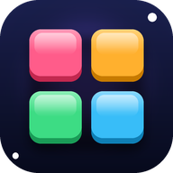

<p align="center">
  
</p>
<h1 align="center">Block Blasters</h1>
<p align="center">Endless 8×8 block puzzle — drag, clear lines, chain combos, chase your highscore.<br>
Zero dependencies, zero build step, installable as a PWA.</p>

## Features

- **Endless mode** – play as long as your board allows; level up every few hundred points
- **Daily Challenge** – one seeded board per day, everyone gets the same opening pieces, separate daily best
- **5 themes that unlock by score** – Neon Night → Ocean Classic (2,500) → Colorful Wood (6,000) → Lava Ruby (12,000) → Galaxy (20,000). They switch mid-game with a big unlock banner; pin a favourite in Settings
- **Highscore & stats** – best score, average, lines, max combo, last 10 games (stored locally)
- **Revive** – first one free, extras cost coins; blasts 3 rows + 3 columns and deals fresh pieces
- **Combos** – consecutive line clears multiply your score (a combo survives a single miss); the combo number is stamped on every block about to pop, the score changes colour with your combo tier and the board gets a rainbow frame during a streak
- **Praise banners** – Cool! / Great! / Amazing! / Unbelievable! / Combo Master / 2 Colors Gone! / ALL CLEAR ×combo
- **Effects** – particles, screen shake, line flashes, combo rings, floating scores, confetti, start-of-game ripple, twinkling empty slots
- **Sound & haptics** – fully procedural WebAudio sounds (no audio files), vibration on mobile
- **Smooth drag & drop** – pointer events, lift-above-finger on touch, snap preview that shows which lines will clear
- **Auto-save** – close the tab and continue later from the main menu
- **Loading screen, pause menu, settings** (sound, vibration, placement preview, effect quality – Auto adapts to the phone's real frame rate)
- **PWA** – manifest, icons, offline service worker, installable on iOS / Android / desktop

## Run locally

Any static file server works (ES modules need `http://`, not `file://`):

```bash
npx serve .
# or
python3 -m http.server 8000
```

## Deploy to Vercel

1. Push this repository to GitHub (already done if you are reading this there).
2. Go to [vercel.com/new](https://vercel.com/new), import **Blockblasters**.
3. Framework preset: **Other**. Leave build command and output directory empty.
4. Deploy. That's it — `vercel.json` already sets clean URLs and cache headers.

Or from the CLI:

```bash
npm i -g vercel
vercel --prod
```

## Project structure

```
index.html            app shell + all screens
css/style.css         design system, HUD, overlays, animations
js/main.js            bootstrap, game flow, screens, autosave
js/game.js            pure rules: board, pieces, scoring, combos, revive, serialize
js/shapes.js          piece catalogue
js/themes.js          themes, palettes, unlock thresholds
js/render.js          canvas renderer, sprites, drag & drop, animations
js/fx.js              particles, confetti, floating text, shake, rings
js/audio.js           procedural sound engine
js/storage.js         localStorage (profile, settings, saved game)
js/ui.js              DOM helpers, HUD tweens, toasts
assets/               logo, favicon, PWA icons, OG image
manifest.webmanifest  PWA manifest
sw.js                 offline service worker (network-first)
vercel.json           headers + clean URLs
```

## Scoring

| Action | Points |
|---|---|
| Place a piece | 1 per cell |
| Clear *n* lines at once | (80·n + 40·n·(n−1)) × combo |
| ALL CLEAR (empty board) | +500 × combo (min ×2) |

Coins: +1 per line, +combo count when combo ≥ 2, +3 when a clear is only 1–2 colours, +25 for an all clear, +10 per level-up. A revive costs 100 coins after the free one (max 5 per game).

## License

MIT
